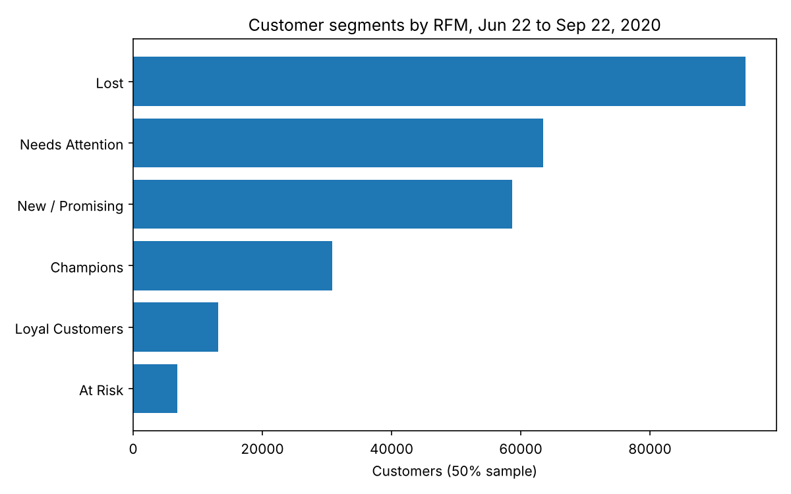
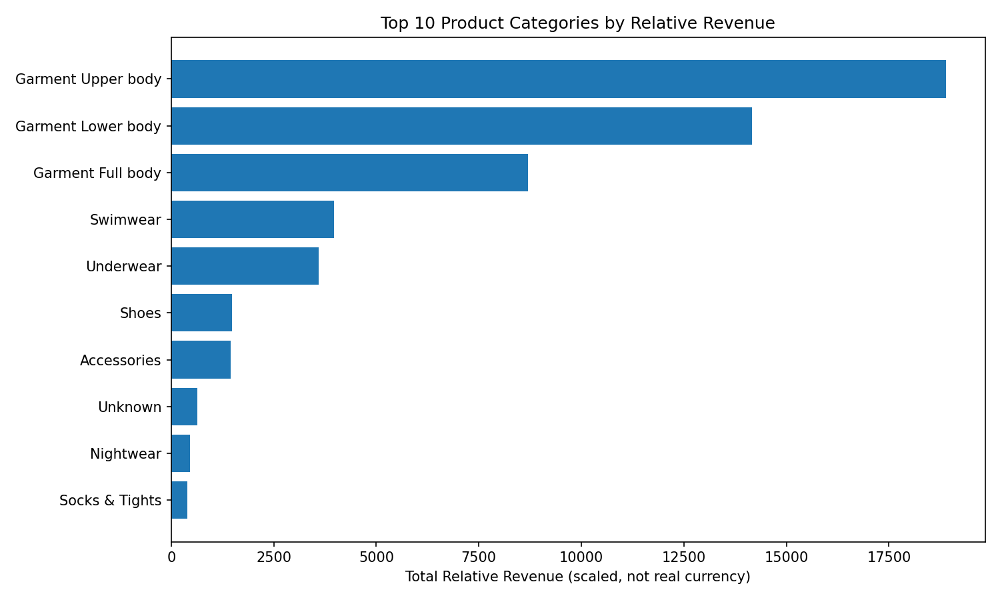
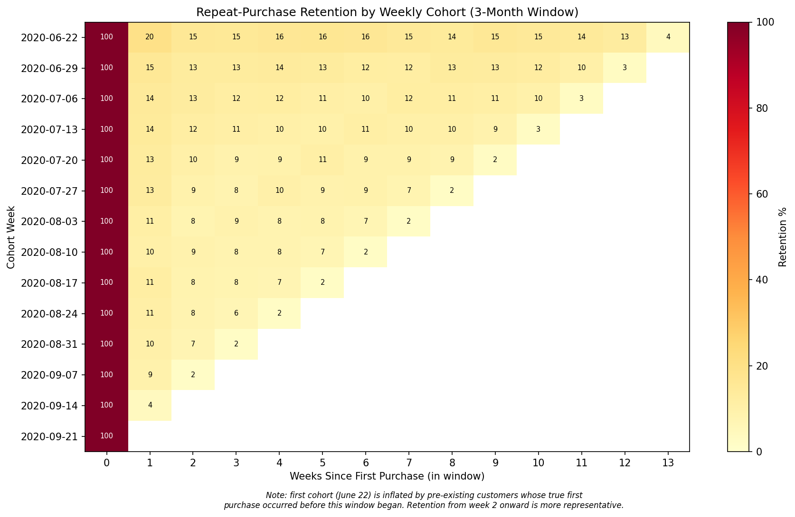
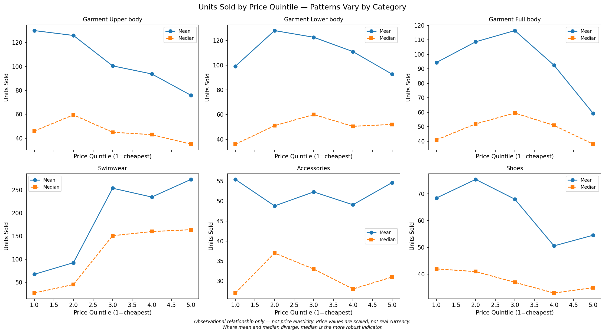

# H&M Retail Analytics: segmentation, retention and product performance

Customer segmentation, weekly cohort retention and product performance on three months of H&M's public transaction data, built on PostgreSQL and Python. Some of the most useful results here are about what the data *can't* tell you, and the write-up says so plainly.

**Dashboard:** _Tableau Public link coming soon_

---

## The data

The source is H&M Group's [Personalized Fashion Recommendations](https://www.kaggle.com/competitions/h-and-m-personalized-fashion-recommendations) Kaggle competition. The full transaction log has 31.8M rows from Sep 2018 to Sep 2020.

This project uses the final three months (Jun 22 to Sep 22, 2020) and a **50% random sample of the customers** active in that window, keeping every one of their transactions. That works out to **267,708 customers and 2,029,325 transactions**. Customers were sampled rather than rows so each purchase history stays complete.

One thing to know before reading any chart: **`price` is anonymized and scaled by H&M.** It isn't currency. Every spend or revenue figure below is in scaled price units.

## What I found

### A third of customers had already lapsed



RFM scoring splits the 267,708 customers into six segments. **Lost is the largest: 94,796 customers (35.4%)** bought on only one or two days and hadn't come back in the final 47+ days of the window. On the other end, Champions are 11.5% of customers and generate 33.5% of scaled spend.

Half of all customers bought on exactly one day in three months. That single fact shapes the whole segmentation. An earlier version of the scoring broke those ties by row order, which put thousands of one-time buyers in the wrong segment. The published version fixes it (see [data notes](docs/data-notes.md#customer-segmentation-rfm)).

### Units and revenue tell different stories



Rank categories by units and by revenue and you get different lists. Accessories sold more than twice the units of Shoes (99,723 vs 44,458) and still brought in slightly less scaled revenue, because the average accessory costs less than half as much. Upper body leads on volume, and Lower body earns about 25% more per unit sold (0.0320 vs 0.0255 scaled).

The top three garment categories make up 71.7% of all units.

### Retention drops after week one, then holds



Customers are grouped by the week they first bought within the window. Excluding the first cohort (explained below), 9 to 15% come back the following week. After that, retention flattens instead of sliding toward zero: in any given week, roughly one in ten customers from each cohort buys again.

Earlier cohorts retain better than later ones. Part of that is probably the same left-censoring effect that inflates the first cohort, fading out week by week, so I wouldn't read it as acquisition getting worse.

### Price and volume don't follow one rule



Within each category, articles were split into five price bands:

- **Garment Upper body:** average volume falls steadily as price rises (130 to 76 units per article). This is the textbook pattern, and it's the only category where it shows up clearly. Medians show it less cleanly.
- **Garment Full body:** an inverted U. Mid-priced items outsell both the cheapest and the most expensive.
- **Swimwear:** volume *rises* with price. The top band's median is about six times the bottom's.
- **Accessories:** flat. Price tells you nothing about volume here.

So "higher prices suppress sales" is false for at least two categories in this data.

## What this data can't support

This part matters as much as the findings.

- **Real money.** Prices are scaled, so nothing here translates to dollars, margins or actual revenue.
- **True churn or lifetime retention.** Three months is too short. "Lost" means lapsed within the window, and "first purchase" means the first one this data can see.
- **The first cohort at face value.** The week of June 22 has 61,829 customers, nearly double the next cohort, and higher retention too. It sweeps in regulars who were shopping before the window started. It stays in the heatmap with a label, and the headline numbers leave it out.
- **Monthly cohorts.** Three months gives three or four cohorts with almost no follow-up. Weekly cohorts were a deliberate choice for that reason.
- **Named worst sellers.** At a 10-unit floor, 454 articles are tied at exactly 10 units, so any "bottom 5" is an arbitrary pick. The honest finding is the distribution: about half the articles in the top three categories (13,389 of 26,894) sold fewer than 10 units.
- **Price elasticity.** No article was sold at two prices on purpose. These are comparisons across different articles, so they're observational and not causal.
- **Trusting a correlation coefficient alone.** Garment Full body has a clear inverted U and a Spearman r of -0.04. A curve that goes up then down cancels out, so a near-zero correlation doesn't mean no relationship. Only Swimwear shows a meaningful correlation (Spearman 0.41).
- **Statistical significance as importance.** Garment Upper body has p < 0.0001 and Spearman r of -0.075. With 6,820 articles, almost any relationship is "significant". The effect size is what counts.

The full list, with every caveat and number, is in [`docs/data-notes.md`](docs/data-notes.md).

## How it was built

1. **Load.** Raw CSVs were filtered and sampled in pandas, then streamed into Supabase PostgreSQL with `psycopg2`'s `copy_expert`, after the browser importer ran out of memory partway through.
2. **Foreign keys.** Validating each row against `customers` and `articles` during the bulk load hit the statement timeout. Dropping the two foreign keys, loading, then rebuilding them validated every row against its parent table in one pass instead.
3. **Checks.** Row counts and date ranges were verified against the source after loading, and category units sum exactly to the transaction count (2,029,325), so the article join neither drops nor duplicates rows.
4. **Analysis.** SQL for extraction and aggregation, pandas and SciPy for scoring, quintiles and correlations.

```
notebooks/   01 load and sample · 02 RFM · 03 cohorts · 04 product performance
sql/         schema DDL and the analysis queries
outputs/     figures and summary tables
dashboard/   Tableau extracts and build notes
docs/        data notes
scripts/     builds the Tableau extracts from the processed data
```

## Reproducing it

1. Download `transactions_train.csv`, `customers.csv` and `articles.csv` from the [Kaggle competition](https://www.kaggle.com/competitions/h-and-m-personalized-fashion-recommendations/data) into `data/raw/`. You need a Kaggle account and have to accept the competition rules. The data isn't redistributed here.
2. `pip install -r requirements.txt`
3. Create a PostgreSQL database (I used Supabase), run `sql/create_tables.sql`, and copy `.env.example` to `.env` with your connection string. On Supabase, use the Session pooler string. The direct connection is IPv6-only.
4. Run the notebooks in order. Notebook 01 writes the processed CSVs and loads the database.
5. `python scripts/build_tableau_extracts.py` builds the remaining dashboard files.

---

Data: H&M Group, via Kaggle. This is an independent portfolio project using only the public competition data. It isn't affiliated with or endorsed by H&M.
